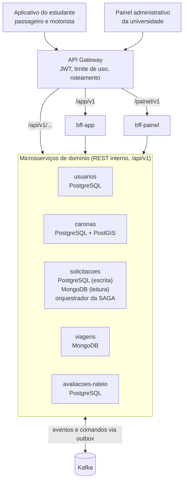
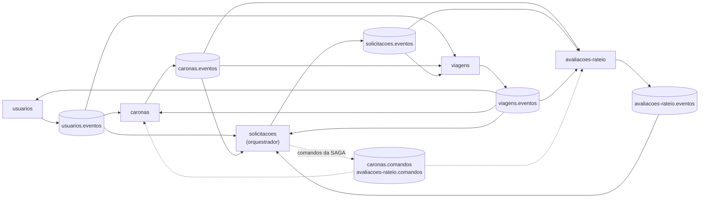

# UniRide — Parte 2: Arquitetura

## Visão geral

A UniRide é decomposta em **cinco microsserviços de domínio**, atrás de um API Gateway e de dois BFFs (um para o aplicativo do estudante e outro para o painel administrativo da universidade). Solicitar uma carona é uma **SAGA orquestrada** e a busca de caronas compatíveis usa **CQRS**. Cada decisão parte do que a Parte 1 define como centro da solução: conectar estudantes para compartilhar caronas, verificar o vínculo institucional, combinar rotas, dividir custos de forma simbólica e aumentar a segurança.

### O que a Parte 1 exige da arquitetura

| Objetivo da UniRide | Como a arquitetura ajuda |
| --- | --- |
| Verificar que os usuários são estudantes | `usuarios-service`, único emissor de tokens, com a claim `verificado` que o gateway confere |
| Encontrar caronas compatíveis | Modelo de leitura do CQRS no `solicitacoes-service`, otimizado para rota e horário de aula |
| Evitar reservar a mesma vaga para várias pessoas | Vagas sob controle exclusivo do `caronas-service` e retenção de vaga dentro da SAGA |
| Manter os serviços sincronizados após eventos | Outbox, eventos no Kafka e consistência eventual declarada |
| Oferecer experiências diferentes por cliente | `bff-app` (estudante) e `bff-painel` (administração da universidade) |
| Acompanhar viagens e tratar situações de risco | `viagens-service`: checagem de embarque, trajeto compartilhado e botão de emergência |
| Dividir custos de forma transparente e simbólica | `avaliacoes-rateio-service`: apenas calcula e registra a contribuição estimada; não há pagamento |
| Avaliação mútua obrigatória | `avaliacoes-rateio-service`: avaliações, reputação e nota de segurança percebida |
| Medir o impacto (seis indicadores) | Endpoints de indicadores agregados e anonimizados, compostos pelo `bff-painel` |

### Decisões em uma tabela

| Tema | Decisão | Seção |
| --- | --- | --- |
| Microsserviços | `usuarios`, `caronas`, `solicitacoes`, `viagens`, `avaliacoes-rateio` | 4.1 |
| REST | Versionamento por URI (`/api/v1`); HAL como formato HATEOAS no recurso `Carona` | 4.2 |
| Gateway | Roteamento por prefixo de recurso, JWT, limite de uso, CORS, correlation id; sem agregação nem regra de negócio | 4.3 |
| BFF | `bff-app` (estudantes) e `bff-painel` (administração da universidade) | 4.4 |
| Dados | Um banco por serviço: PostgreSQL, PostgreSQL com PostGIS, MongoDB; Kafka com outbox | 4.5 |
| SAGA | Orquestrada, no `solicitacoes-service`: solicitar carona, reservar vaga e registrar contribuição estimada | 4.6 |
| CQRS | Busca de caronas compatíveis: escrita em PostgreSQL, leitura em MongoDB; defasagem aceitável de 5 s | 4.7 |

---

## 4.1 Decomposição em microsserviços

Os cortes seguem responsabilidades de negócio (*bounded contexts*), não entidades: cada serviço é dono das suas regras, dos seus dados e do seu ritmo de mudança. São **cinco serviços de domínio**.

### Serviços, responsabilidades e donos dos dados

| Serviço | Responsabilidade | Dados que possui | Funcionalidades da Parte 1 |
| --- | --- | --- | --- |
| `usuarios-service` (Usuários e Verificação) | Cadastro, login e emissão de JWT, verificação do vínculo institucional, perfil, veículos, contatos de emergência | Usuários, vínculos, veículos, contatos | E-mail institucional, matrícula, perfil verificado |
| `caronas-service` (Caronas) | Oferta de carona pelo motorista (rota, horário, público) e **controle das vagas** | Caronas, vagas (livres, retidas, confirmadas) | Origem, destino, horário, vagas, veículo |
| `solicitacoes-service` (Solicitações e Matching) | Pedidos de vaga dos passageiros, **orquestrador da SAGA** e busca de caronas compatíveis | Solicitações, estado das SAGAs, modelo de leitura da busca | Match de rotas e solicitação de carona |
| `viagens-service` (Viagens e Segurança) | Partida e chegada, checagem de embarque, trajeto em tempo real, botão de emergência | Viagens, check-ins, posições (com expiração), alertas | Checagem de embarque, compartilhamento de trajeto, emergência |
| `avaliacoes-rateio-service` (Avaliações e Rateio) | Avaliação mútua, reputação e **cálculo e registro** da contribuição estimada | Avaliações, notas agregadas, contribuições | Avaliação mútua, divisão transparente dos custos |

A fronteira mais delicada é a que separa **Caronas** de **Solicitações e Matching**: o `caronas-service` gerencia as vagas disponíveis; o `solicitacoes-service` gerencia os pedidos para ocupá-las. Quem decide se existe vaga é sempre o primeiro; o segundo apenas pede e acompanha o resultado.

### Por que este corte e não outro

Quatro critérios decidiram cada fronteira: dono dos dados e das invariantes; motivo e ritmo de mudança; requisitos não funcionais distintos; ausência de chamada síncrona entre serviços no caminho crítico.

| Alternativa descartada | Por que descartamos |
| --- | --- |
| Serviço de Pagamentos | Não há cobrança, carteira nem Pix dentro da UniRide: o serviço de Rateio só calcula e registra a contribuição estimada. |
| Um serviço de *matching* separado | A busca é uma consulta derivada das ofertas de carona. Separar duplicaria os dados e exigiria *join* síncrono. Ela vive no lado de leitura do `solicitacoes-service` (CQRS, 4.7) |
| Solicitações dentro do `caronas-service` | O `caronas-service` é dono da capacidade (vagas nunca excedem o total); a solicitação é a intenção do passageiro, com ciclo próprio, invariabilidade e a coordenação da SAGA. Juntar os dois deixaria a SAGA sem um coordenador que não seja participante |
| Embarque, trajeto e emergência em serviços próprios | São a mesma capacidade (segurança durante a viagem), com os mesmos requisitos de disponibilidade e retenção curta de localização. Ficam dentro de Viagens e Segurança |
| Segurança dentro do `caronas-service` | O alerta de emergência não pode depender de a busca ou a oferta de caronas estarem no ar, e a localização tem retenção curta (LGPD) |
| Avaliações e Rateio em serviços separados | Os dois acontecem depois da viagem, são pequenos e compartilham a ligação com a solicitação. Mantê-los juntos reduz complexidade. Podem se separar no futuro se o rateio crescer |
| Serviço de notificações | Push e e-mail são um adaptador de infraestrutura, não um contexto de negócio. O estado em tempo real chega ao aplicativo por SSE, pelo `bff-app` |
| Um serviço por entidade (`veículo`, `contato`...) | Gera excesso de chamadas e transações distribuídas sem ganho de autonomia |

### Autenticação, verificação institucional e autorização

São três coisas diferentes. Fazer login não comprova que o vínculo acadêmico está ativo.

| Etapa | Quem faz | Como | Se falhar |
| --- | --- | --- | --- |
| Autenticação (quem é a pessoa) | `usuarios-service` | E-mail e senha; emite JWT de acesso (15 min) e de renovação | `401`; no máximo 5 tentativas por minuto por IP no login |
| Verificação institucional (é estudante com vínculo ativo) | `usuarios-service` | Código enviado ao e-mail do domínio da instituição. Ao confirmar o código, o token passa a trazer verificado=`true`. | Código errado: `422`; três erros bloqueiam por 15 min. Código vencido: `410`. E-mail fora do domínio autorizado: `422`. A conta continua NAO_VERIFICADO até a confirmação. |
| Autorização (o que pode fazer) | Gateway (regra grossa) e cada serviço (regra fina) | Papéis `ESTUDANTE` e `ADMIN_INSTITUCIONAL`; claim `verificado`; "só o dono edita a carona", "só o passageiro cancela a sua solicitação" | `403` |

Reação à falha de verificação:

- **Conta não verificada:** consegue entrar, ver e editar o perfil e repetir a verificação. O gateway devolve `403` em `caronas`, `solicitacoes` e `viagens`. Ninguém usa a plataforma sem vínculo comprovado.
- **Conta suspensa** (por exemplo, quando a instituição informa o desligamento do estudante e a administração suspende a conta): o token não é renovado (vale até 15 min, e uma lista de revogação em Redis consultada pelo gateway fecha essa janela). O `caronas-service` cancela as caronas abertas do motorista, o `solicitacoes-service` cancela as solicitações pendentes, e uma viagem já em andamento termina normalmente.

### Diagrama de componentes

### Diagrama de comunicação entre serviços

Os serviços não se chamam por REST. Cada um publica fatos (eventos) no seu tópico, e quem precisa reagir assina. As linhas pontilhadas são comandos da SAGA, enviados pelo orquestrador.

### Regras de comunicação

- **Cliente → Gateway → serviço ou BFF:** REST síncrono, apenas para consultas e comandos iniciados pelo usuário.
- **Serviço ↔ serviço:** somente assíncrono, por Kafka. Nenhum serviço de domínio chama outro por REST no caminho crítico; isso evita acoplamento temporal e falha em cascata.
- **Dado de outro serviço** entra como cópia local mínima, mantida por eventos: nome e nota do motorista no modelo de leitura da busca; rota e distância das caronas no serviço de rateio; contatos de emergência no `viagens-service`, que assim funciona mesmo com o `usuarios-service` fora do ar.
- A única chamada síncrona entre serviços é a busca das chaves públicas (JWKS) do `usuarios-service`, em cache.

### Catálogo de eventos

| Tópico | Produtor | Eventos | Consumidores |
| --- | --- | --- | --- |
| `usuarios.eventos` | usuarios | `UsuarioCadastrado`, `UsuarioVerificado`, `UsuarioSuspenso`, `PerfilAtualizado` | caronas, solicitacoes, viagens |
| `caronas.eventos` | caronas | `CaronaOfertada`, `CaronaAtualizada`, `CaronaCancelada`, `VagaRetida`, `VagaRecusada`, `VagaConfirmada`, `ConfirmacaoVagaFalhou`, `VagaLiberada` | solicitacoes, viagens, avaliacoes-rateio |
| `solicitacoes.eventos` | solicitacoes | `SolicitacaoCriada`, `SolicitacaoConfirmada`, `SolicitacaoRecusada`, `SolicitacaoCancelada` | viagens, avaliacoes-rateio |
| `viagens.eventos` | viagens | `ViagemIniciada`, `ViagemConcluida`, `CheckinEmbarqueRealizado`, `AlertaEmergenciaAcionado` | usuarios (contador de viagens), caronas, solicitacoes, avaliacoes-rateio |
| `avaliacoes-rateio.eventos` | avaliacoes-rateio | `ContribuicaoEstimadaRegistrada`, `RegistroContribuicaoFalhou`, `ContribuicaoCancelada`, `AcertoRegistrado`, `AvaliacaoRegistrada`, `ReputacaoAtualizada` | solicitacoes |
| `caronas.comandos` | solicitacoes (orquestrador) | `ReservarVaga`, `ConfirmarVaga`, `LiberarVaga` | caronas |
| `avaliacoes-rateio.comandos` | solicitacoes (orquestrador) | `RegistrarContribuicaoEstimada`, `CancelarContribuicao` | avaliacoes-rateio |
