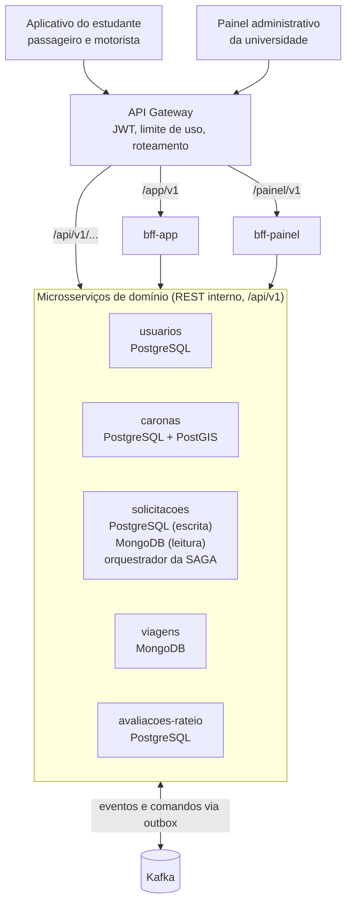
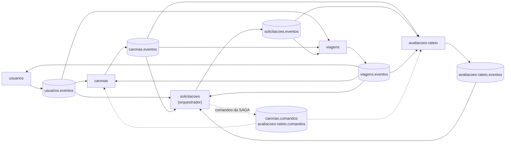

# UniRide — Parte 2: Arquitetura

## Visão geral

A UniRide é decomposta em **cinco microsserviços de domínio**, atrás de um API Gateway e de dois BFFs (um para o aplicativo do estudante e outro para o painel administrativo da universidade). Solicitar uma carona é uma **SAGA orquestrada** e a busca de caronas compatíveis usa **CQRS**. Cada decisão parte do que a Parte 1 define como centro da solução: conectar estudantes para compartilhar caronas, verificar o vínculo institucional, combinar rotas, dividir custos de forma simbólica e aumentar a segurança.

### O que a Parte 1 exige da arquitetura

| Objetivo da UniRide | Como a arquitetura ajuda |
| --- | --- |
| Verificar que os usuários são estudantes | `usuarios-service`, único emissor de tokens, com a claim `verificado` que o gateway confere |
| Encontrar caronas compatíveis | Modelo de leitura do CQRS no `solicitacoes-service`, otimizado para rota e horário de aula |
| Evitar reservar a mesma vaga para várias pessoas | Vagas sob controle exclusivo do `caronas-service` e retenção de vaga dentro da SAGA |
| Manter os serviços sincronizados após eventos | Outbox, eventos no Kafka e consistência eventual declarada |
| Oferecer experiências diferentes por cliente | `bff-app` (estudante) e `bff-painel` (administração da universidade) |
| Acompanhar viagens e tratar situações de risco | `viagens-service`: checagem de embarque, trajeto compartilhado e botão de emergência |
| Dividir custos de forma transparente e simbólica | `avaliacoes-rateio-service`: apenas calcula e registra a contribuição estimada; não há pagamento |
| Avaliação mútua obrigatória | `avaliacoes-rateio-service`: avaliações, reputação e nota de segurança percebida |
| Medir o impacto (seis indicadores) | Endpoints de indicadores agregados e anonimizados, compostos pelo `bff-painel` |

### Decisões em uma tabela

| Tema | Decisão | Seção |
| --- | --- | --- |
| Microsserviços | `usuarios`, `caronas`, `solicitacoes`, `viagens`, `avaliacoes-rateio` | 4.1 |
| REST | Versionamento por URI (`/api/v1`); HAL como formato HATEOAS no recurso `Carona` | 4.2 |
| Gateway | Roteamento por prefixo de recurso, JWT, limite de uso, CORS, correlation id; sem agregação nem regra de negócio | 4.3 |
| BFF | `bff-app` (estudantes) e `bff-painel` (administração da universidade) | 4.4 |
| Dados | Um banco por serviço: PostgreSQL, PostgreSQL com PostGIS, MongoDB; Kafka com outbox | 4.5 |
| SAGA | Orquestrada, no `solicitacoes-service`: solicitar carona, reservar vaga e registrar contribuição estimada | 4.6 |
| CQRS | Busca de caronas compatíveis: escrita em PostgreSQL, leitura em MongoDB; defasagem aceitável de 5 s | 4.7 |

---

## 4.1 Decomposição em microsserviços

Os cortes seguem responsabilidades de negócio (*bounded contexts*), não entidades: cada serviço é dono das suas regras, dos seus dados e do seu ritmo de mudança. São **cinco serviços de domínio**.

### Serviços, responsabilidades e donos dos dados

| Serviço | Responsabilidade | Dados que possui | Funcionalidades da Parte 1 |
| --- | --- | --- | --- |
| `usuarios-service` (Usuários e Verificação) | Cadastro, login e emissão de JWT, verificação do vínculo institucional, perfil, veículos, contatos de emergência | Usuários, vínculos, veículos, contatos | E-mail institucional, matrícula, perfil verificado |
| `caronas-service` (Caronas) | Oferta de carona pelo motorista (rota, horário, público) e **controle das vagas** | Caronas, vagas (livres, retidas, confirmadas) | Origem, destino, horário, vagas, veículo |
| `solicitacoes-service` (Solicitações e Matching) | Pedidos de vaga dos passageiros, **orquestrador da SAGA** e busca de caronas compatíveis | Solicitações, estado das SAGAs, modelo de leitura da busca | Match de rotas e solicitação de carona |
| `viagens-service` (Viagens e Segurança) | Partida e chegada, checagem de embarque, trajeto em tempo real, botão de emergência | Viagens, check-ins, posições (com expiração), alertas | Checagem de embarque, compartilhamento de trajeto, emergência |
| `avaliacoes-rateio-service` (Avaliações e Rateio) | Avaliação mútua, reputação e **cálculo e registro** da contribuição estimada | Avaliações, notas agregadas, contribuições | Avaliação mútua, divisão transparente dos custos |

A fronteira mais delicada é a que separa **Caronas** de **Solicitações e Matching**: o `caronas-service` gerencia as vagas disponíveis; o `solicitacoes-service` gerencia os pedidos para ocupá-las. Quem decide se existe vaga é sempre o primeiro; o segundo apenas pede e acompanha o resultado.

### Por que este corte e não outro

Quatro critérios decidiram cada fronteira: dono dos dados e das invariantes; motivo e ritmo de mudança; requisitos não funcionais distintos; ausência de chamada síncrona entre serviços no caminho crítico.

| Alternativa descartada | Por que descartamos |
| --- | --- |
| Serviço de Pagamentos | Não há cobrança, carteira nem Pix dentro da UniRide: o serviço de Rateio só calcula e registra a contribuição estimada. |
| Um serviço de *matching* separado | A busca é uma consulta derivada das ofertas de carona. Separar duplicaria os dados e exigiria *join* síncrono. Ela vive no lado de leitura do `solicitacoes-service` (CQRS, 4.7) |
| Solicitações dentro do `caronas-service` | O `caronas-service` é dono da capacidade (vagas nunca excedem o total); a solicitação é a intenção do passageiro, com ciclo próprio, invariabilidade e a coordenação da SAGA. Juntar os dois deixaria a SAGA sem um coordenador que não seja participante |
| Embarque, trajeto e emergência em serviços próprios | São a mesma capacidade (segurança durante a viagem), com os mesmos requisitos de disponibilidade e retenção curta de localização. Ficam dentro de Viagens e Segurança |
| Segurança dentro do `caronas-service` | O alerta de emergência não pode depender de a busca ou a oferta de caronas estarem no ar, e a localização tem retenção curta (LGPD) |
| Avaliações e Rateio em serviços separados | Os dois acontecem depois da viagem, são pequenos e compartilham a ligação com a solicitação. Mantê-los juntos reduz complexidade. Podem se separar no futuro se o rateio crescer |
| Serviço de notificações | Push e e-mail são um adaptador de infraestrutura, não um contexto de negócio. O estado em tempo real chega ao aplicativo por SSE, pelo `bff-app` |
| Um serviço por entidade (`veículo`, `contato`...) | Gera excesso de chamadas e transações distribuídas sem ganho de autonomia |

### Autenticação, verificação institucional e autorização

São três coisas diferentes. Fazer login não comprova que o vínculo acadêmico está ativo.

| Etapa | Quem faz | Como | Se falhar |
| --- | --- | --- | --- |
| Autenticação (quem é a pessoa) | `usuarios-service` | E-mail e senha; emite JWT de acesso (15 min) e de renovação | `401`; no máximo 5 tentativas por minuto por IP no login |
| Verificação institucional (é estudante com vínculo ativo) | `usuarios-service` | Código enviado ao e-mail do domínio da instituição. Ao confirmar o código, o token passa a trazer verificado=`true`. | Código errado: `422`; três erros bloqueiam por 15 min. Código vencido: `410`. E-mail fora do domínio autorizado: `422`. A conta continua NAO_VERIFICADO até a confirmação. |
| Autorização (o que pode fazer) | Gateway (regra grossa) e cada serviço (regra fina) | Papéis `ESTUDANTE` e `ADMIN_INSTITUCIONAL`; claim `verificado`; "só o dono edita a carona", "só o passageiro cancela a sua solicitação" | `403` |

Reação à falha de verificação:

- **Conta não verificada:** consegue entrar, ver e editar o perfil e repetir a verificação. O gateway devolve `403` em `caronas`, `solicitacoes` e `viagens`. Ninguém usa a plataforma sem vínculo comprovado.
- **Conta suspensa** (por exemplo, quando a instituição informa o desligamento do estudante e a administração suspende a conta): o token não é renovado (vale até 15 min, e uma lista de revogação em Redis consultada pelo gateway fecha essa janela). O `caronas-service` cancela as caronas abertas do motorista, o `solicitacoes-service` cancela as solicitações pendentes, e uma viagem já em andamento termina normalmente.

### Diagrama de componentes



### Diagrama de comunicação entre serviços

Os serviços não se chamam por REST. Cada um publica fatos (eventos) no seu tópico, e quem precisa reagir assina. As linhas pontilhadas são comandos da SAGA, enviados pelo orquestrador.



### Regras de comunicação

- **Cliente → Gateway → serviço ou BFF:** REST síncrono, apenas para consultas e comandos iniciados pelo usuário.
- **Serviço ↔ serviço:** somente assíncrono, por Kafka. Nenhum serviço de domínio chama outro por REST no caminho crítico; isso evita acoplamento temporal e falha em cascata.
- **Dado de outro serviço** entra como cópia local mínima, mantida por eventos: nome e nota do motorista no modelo de leitura da busca; rota e distância das caronas no serviço de rateio; contatos de emergência no `viagens-service`, que assim funciona mesmo com o `usuarios-service` fora do ar.
- A única chamada síncrona entre serviços é a busca das chaves públicas (JWKS) do `usuarios-service`, em cache.

### Catálogo de eventos

| Tópico | Produtor | Eventos | Consumidores |
| --- | --- | --- | --- |
| `usuarios.eventos` | usuarios | `UsuarioCadastrado`, `UsuarioVerificado`, `UsuarioSuspenso`, `PerfilAtualizado` | caronas, solicitacoes, viagens |
| `caronas.eventos` | caronas | `CaronaOfertada`, `CaronaAtualizada`, `CaronaCancelada`, `VagaRetida`, `VagaRecusada`, `VagaConfirmada`, `ConfirmacaoVagaFalhou`, `VagaLiberada` | solicitacoes, viagens, avaliacoes-rateio |
| `solicitacoes.eventos` | solicitacoes | `SolicitacaoCriada`, `SolicitacaoConfirmada`, `SolicitacaoRecusada`, `SolicitacaoCancelada` | viagens, avaliacoes-rateio |
| `viagens.eventos` | viagens | `ViagemIniciada`, `ViagemConcluida`, `CheckinEmbarqueRealizado`, `AlertaEmergenciaAcionado` | usuarios (contador de viagens), caronas, solicitacoes, avaliacoes-rateio |
| `avaliacoes-rateio.eventos` | avaliacoes-rateio | `ContribuicaoEstimadaRegistrada`, `RegistroContribuicaoFalhou`, `ContribuicaoCancelada`, `AcertoRegistrado`, `AvaliacaoRegistrada`, `ReputacaoAtualizada` | solicitacoes |
| `caronas.comandos` | solicitacoes (orquestrador) | `ReservarVaga`, `ConfirmarVaga`, `LiberarVaga` | caronas |
| `avaliacoes-rateio.comandos` | solicitacoes (orquestrador) | `RegistrarContribuicaoEstimada`, `CancelarContribuicao` | avaliacoes-rateio |

---

## 4.2 API REST

Cada serviço expõe um contrato REST versionado em `/api/v1`. Recursos são substantivos no plural, a semântica vem do verbo HTTP, e transições de estado viram sub-recursos (`/cancelamento`, `/partida`) em vez de verbos no caminho. Os contratos completos, em OpenAPI 3.0.3, estão na pasta `openapi/` (56 operações em 5 arquivos); as tabelas abaixo os resumem.

### Convenções comuns

| Tema | Regra |
| --- | --- |
| Verbos | `GET` lê (seguro e idempotente); `POST` cria ou dispara transição; `PUT` substitui; `PATCH` altera parcialmente; `DELETE` remove |
| Sucesso | `200` leitura e alteração; `201` criação, com `Location`; `202` aceito para processamento assíncrono (SAGA); `204` sem corpo (remoção, envio de posição) |
| Erro do cliente | `400` requisição malformada; `401` sem token ou expirado; `403` sem permissão (conta não verificada, público da carona); `404`; `409` conflito de estado (sem vaga, duplicidade); `410` link ou código expirado; `412` falha em `If-Match`; `422` regra de negócio violada; `429` limite excedido, com `Retry-After` |
| Corpo de erro | `application/problem+json` (RFC 9457): `type`, `title`, `status`, `detail`, `traceId` |
| Idempotência | `Idempotency-Key` (UUID) obrigatório em `POST /api/v1/solicitacoes` e `POST /api/v1/avaliacoes`; repetir devolve a resposta original |
| Concorrência | `ETag` em recursos editáveis e `If-Match` em `PATCH`; divergência devolve `412` |
| Paginação | `?pagina=0&tamanho=20`; coleções trazem `_links.proxima` e `_links.anterior` |
| Autorização | JWT `Bearer`; `/api/v1/indicadores/*` exige `ADMIN_INSTITUCIONAL`, devolve só agregados e não é exposto pelo gateway |

### Estratégia de versionamento

**Decisão:** versão no caminho da URI (`/api/v1/...`).

- **Por quê:** a versão fica visível nas regras do gateway, nos logs e nos testes; duas versões convivem como rotas distintas para *deploys* distintos; o aplicativo móvel não atualiza junto com o servidor, então a versão precisa ser explícita.
- **Alternativas descartadas:** versão em cabeçalho ou *media type* deixa a URI mais limpa, mas é invisível ao roteamento por prefixo e mais difícil de testar e depurar; parâmetro de consulta mistura versão com filtro.
- **Política:** mudança aditiva (campo opcional novo, endpoint novo) permanece em `v1`. Mudança que quebra (remover ou renomear campo, mudar tipo, mudar status) cria `v2`. A versão anterior segue por pelo menos 90 dias, sinalizada com os cabeçalhos `Deprecation` e `Sunset` (RFC 8594).
- **Duas camadas:** as APIs dos serviços (`/api/v1`) e as APIs dos BFFs (`/app/v1`, `/painel/v1`) têm versões independentes. As dos BFFs são as de vida longa, porque o aplicativo instalado depende delas.
- **Eventos:** o envelope traz `schemaVersion`; só mudanças aditivas, e consumidores ignoram campos desconhecidos.

### Contratos por serviço

#### usuarios-service

Arquivo: `openapi/usuarios-service.yaml`

| Método | Caminho | Descrição | Sucesso | Erros |
| --- | --- | --- | --- | --- |
| POST | `/api/v1/usuarios` | Cadastro (situação inicial `NAO_VERIFICADO`) | 201 | 409, 422, 429 |
| POST | `/api/v1/verificacoes` | Pede a verificação do vínculo; envia código ao e-mail institucional | 202 | 404, 422, 429 |
| POST | `/api/v1/verificacoes/{id}/confirmacao` | Confirma o código | 200 | 400, 410, 422 |
| POST | `/api/v1/sessoes` | Login; emite token de acesso e de renovação | 201 | 401, 403, 429 |
| POST | `/api/v1/sessoes/{id}/renovacao` | Renova o token de acesso | 200 | 401 |
| DELETE | `/api/v1/sessoes/{id}` | Logout | 204 | 404 |
| GET | `/api/v1/usuarios/{id}` | Perfil público (nome, foto, vínculo verificado, veículo) | 200 | 404 |
| GET / PATCH | `/api/v1/usuarios/me` | Perfil completo; alteração com `If-Match` | 200 | 401, 412, 422 |
| GET / POST | `/api/v1/usuarios/me/veiculos` | Lista e cadastra veículos | 200 / 201 | 403, 422 |
| PUT / DELETE | `/api/v1/usuarios/me/veiculos/{veiculoId}` | Atualiza e remove | 200 / 204 | 404, 409, 422 |
| GET / POST | `/api/v1/usuarios/me/contatos-emergencia` | Lista e cadastra contatos de emergência | 200 / 201 | 422 |
| DELETE | `/api/v1/usuarios/me/contatos-emergencia/{id}` | Remove contato | 204 | 404 |
| PATCH | `/api/v1/usuarios/{id}/situacao` | Suspende ou reativa (administração) | 200 | 403, 404 |
| GET | `/api/v1/usuarios/{id}/verificacao` | Situação da verificação do vínculo (administração) | 200 | 403, 404 |
| GET | `/api/v1/chaves-publicas` | Chaves públicas (JWKS) para validar o JWT | 200 | — |
| GET | `/api/v1/indicadores/adesao-feminina` | Adesão de mulheres (indicador 4) | 200 | 403, 422 |

#### caronas-service

Arquivo: `openapi/caronas-service.yaml`

| Método | Caminho | Descrição | Sucesso | Erros |
| --- | --- | --- | --- | --- |
| POST | `/api/v1/caronas` | Oferece carona (rota, horário, vagas, público) | 201 | 403, 422 |
| GET | `/api/v1/caronas` | Minhas caronas como motorista (`situacao`) | 200 | — |
| GET | `/api/v1/caronas/{id}` | Detalhe da carona, **com links HATEOAS** | 200 | 404 |
| PATCH | `/api/v1/caronas/{id}` | Altera horário, vagas ou ponto de saída, com `If-Match` | 200 | 403, 404, 409, 412, 422 |
| POST | `/api/v1/caronas/{id}/cancelamento` | Cancela a carona (as solicitações abertas são canceladas por evento) | 202 | 403, 404, 409 |

Comandos assíncronos da SAGA, fora do REST: `ReservarVaga`, `ConfirmarVaga`, `LiberarVaga` (tópico `caronas.comandos`).

#### solicitacoes-service

Arquivo: `openapi/solicitacoes-service.yaml`

| Lado | Método | Caminho | Descrição | Sucesso | Erros |
| --- | --- | --- | --- | --- | --- |
| Escrita | POST | `/api/v1/solicitacoes` | Solicita vaga e inicia a SAGA (`Idempotency-Key`) | 202 | 403, 409, 422, 429 |
| Escrita | POST | `/api/v1/solicitacoes/{id}/cancelamento` | Cancela a solicitação | 202 | 404, 409 |
| Escrita (leitura direta) | GET | `/api/v1/solicitacoes/{id}` | Solicitação | 200 | 403, 404 |
| Escrita (leitura direta) | GET | `/api/v1/solicitacoes` | Minhas solicitações (`situacao`) ou, para o motorista, `?caronaId=` | 200 | 403 |
| Escrita (leitura direta) | GET | `/api/v1/solicitacoes/{id}/saga` | Estado e histórico da SAGA (diagnóstico) | 200 | 403, 404 |
| Leitura (CQRS) | GET | `/api/v1/caronas-compativeis` | Busca por origem, destino, `chegarAte`, `raioMetros`, `publico` | 200 | 422 |
| Leitura (CQRS) | GET | `/api/v1/caronas-compativeis/{caronaId}` | Uma carona no formato do modelo de leitura | 200 | 404 |
| — | GET | `/api/v1/indicadores/efetividade-match` | Solicitações que viram viagem concluída (indicador 5) | 200 | 403, 422 |
| — | GET | `/api/v1/indicadores/retencao` | Nova viagem em até 30 dias (indicador 3) | 200 | 403, 422 |

Comandos assíncronos enviados por este serviço (orquestrador), fora do REST: `ReservarVaga`, `ConfirmarVaga`, `LiberarVaga`, `RegistrarContribuicaoEstimada`, `CancelarContribuicao`.

#### viagens-service

Arquivo: `openapi/viagens-service.yaml`

| Método | Caminho | Descrição | Sucesso | Erros |
| --- | --- | --- | --- | --- |
| GET | `/api/v1/viagens/{caronaId}` | Situação da viagem e dos passageiros | 200 | 403, 404 |
| POST | `/api/v1/viagens/{caronaId}/partida` | Inicia a viagem (motorista) | 201 | 403, 409 |
| POST | `/api/v1/viagens/{caronaId}/chegada` | Conclui a viagem (motorista) | 201 | 403, 409 |
| POST | `/api/v1/viagens/{caronaId}/checkins-embarque` | Checagem de embarque por código | 201 | 403, 409, 422 |
| POST | `/api/v1/viagens/{caronaId}/posicoes` | Envia a posição durante a viagem | 204 | 403, 409 |
| POST | `/api/v1/viagens/{caronaId}/compartilhamentos` | Cria o link de acompanhamento para um contato | 201 | 403, 409 |
| GET | `/api/v1/viagens-compartilhadas/{token}` | Acompanha a viagem (público, somente leitura) | 200 | 404, 410 |
| POST | `/api/v1/viagens/{caronaId}/alertas-emergencia` | Aciona o botão de emergência | 201 | 403, 404 |
| GET | `/api/v1/alertas-emergencia/{id}` | Consulta o alerta | 200 | 403, 404 |
| PATCH | `/api/v1/alertas-emergencia/{id}` | Atualiza ou encerra (segurança institucional) | 200 | 403, 409 |
| GET | `/api/v1/indicadores/viagens-concluidas` | Caronas concluídas (indicador 6) | 200 | 403, 422 |

#### avaliacoes-rateio-service

Arquivo: `openapi/avaliacoes-rateio-service.yaml`

| Método | Caminho | Descrição | Sucesso | Erros |
| --- | --- | --- | --- | --- |
| GET | `/api/v1/estimativas-contribuicao?caronaId=` | Estimativa por passageiro, com a conta aberta | 200 | 404, 422 |
| GET | `/api/v1/contribuicoes` | Contribuições do usuário (`solicitacaoId`, `situacao`) | 200 | — |
| GET | `/api/v1/contribuicoes/{id}` | Detalhe (distância, custo, divisão) | 200 | 403, 404 |
| POST | `/api/v1/contribuicoes/{id}/acerto` | Motorista registra que o acerto foi feito (só registro) | 201 | 403, 404, 409 |
| GET | `/api/v1/economia?periodo=` | Economia gerada pelo usuário no período | 200 | 422 |
| POST | `/api/v1/avaliacoes` | Avalia o outro participante (nota geral e de segurança) | 201 | 403, 409, 422 |
| GET | `/api/v1/avaliacoes/pendentes` | Avaliações obrigatórias pendentes | 200 | — |
| GET | `/api/v1/reputacoes/{usuarioId}` | Nota agregada e total de viagens avaliadas | 200 | 404 |
| GET | `/api/v1/reputacoes/{usuarioId}/avaliacoes` | Avaliações recebidas (paginado) | 200 | 404 |
| GET | `/api/v1/indicadores/economia-media` | Economia média por estudante (indicador 1) | 200 | 403, 422 |
| GET | `/api/v1/indicadores/seguranca-percebida` | Média das notas de segurança (indicador 2) | 200 | 403, 422 |

Comandos assíncronos: `RegistrarContribuicaoEstimada`, `CancelarContribuicao` (tópico `avaliacoes-rateio.comandos`).

### HATEOAS no recurso Carona

O recurso com HATEOAS é a **carona**: `GET /api/v1/caronas/42`. O que cada pessoa pode fazer depende do estado da carona e de quem consulta. O servidor devolve em `_links` apenas as ações válidas naquele momento, e o cliente segue os links em vez de montar URLs ou replicar regras. Formato: HAL (`application/hal+json`); a propriedade `method` é uma extensão nossa, já que HAL não define o verbo.

Um passageiro verificado, com a carona aberta e vagas livres:

```json
{
  "id": "42",
  "motoristaId": "91",
  "origem":  { "descricao": "Praça Central", "lat": -21.20, "lng": -45.00 },
  "destino": { "descricao": "Campus, Portaria 2", "lat": -21.15, "lng": -45.05 },
  "saidaEm": "2026-10-23T06:40:00-03:00",
  "vagasTotais": 3,
  "vagasLivres": 2,
  "publico": "SOMENTE_MULHERES",
  "situacao": "ABERTA",
  "_links": {
    "self":                    { "href": "/api/v1/caronas/42" },
    "motorista":               { "href": "/api/v1/usuarios/91" },
    "reputacao-motorista":     { "href": "/api/v1/reputacoes/91" },
    "estimativa-contribuicao": { "href": "/api/v1/estimativas-contribuicao?caronaId=42" },
    "solicitar-vaga":          { "href": "/api/v1/solicitacoes", "method": "POST" }
  }
}
```

A mesma carona vista pelo motorista (sem `solicitar-vaga`; com as ações de dono):

```json
{
  "id": "42",
  "vagasLivres": 2,
  "situacao": "ABERTA",
  "_links": {
    "self":           { "href": "/api/v1/caronas/42" },
    "solicitacoes":   { "href": "/api/v1/solicitacoes?caronaId=42" },
    "editar":         { "href": "/api/v1/caronas/42", "method": "PATCH" },
    "cancelar":       { "href": "/api/v1/caronas/42/cancelamento", "method": "POST" },
    "iniciar-viagem": { "href": "/api/v1/viagens/42/partida", "method": "POST" }
  }
}
```

| Situação e quem consulta | Links devolvidos além de `self` |
| --- | --- |
| `ABERTA`, passageiro verificado e elegível | `motorista`, `reputacao-motorista`, `estimativa-contribuicao`, `solicitar-vaga` |
| `ABERTA`, motorista | `solicitacoes`, `editar`, `cancelar`, `iniciar-viagem` (perto do horário) |
| `LOTADA` | `motorista`, `buscar-outras` (modelo de URL, `templated: true`) |
| `EM_VIAGEM` | `motorista`; para o motorista, também `chegada` |
| `CONCLUIDA` ou `CANCELADA` | `buscar-outras` |

Se o usuário não for elegível ao público da carona (por exemplo, `SOMENTE_MULHERES`), o link `solicitar-vaga` não aparece, e a tentativa direta de `POST /api/v1/solicitacoes` devolve `403`.

### Trecho do contrato OpenAPI

O endpoint que inicia a SAGA, como está em `openapi/solicitacoes-service.yaml` (versão resumida):

```yaml
openapi: 3.0.3
info: { title: UniRide solicitacoes-service, version: 1.0.0 }
paths:
  /api/v1/solicitacoes:
    post:
      summary: Solicita uma vaga em uma carona e inicia a SAGA
      operationId: criarSolicitacao
      parameters:
        - in: header
          name: Idempotency-Key
          required: true
          schema: { type: string, format: uuid }
      requestBody:
        required: true
        content:
          application/json:
            schema: { $ref: '#/components/schemas/PedidoSolicitacao' }
      responses:
        '202':
          description: Solicitação aceita em PENDENTE; a SAGA segue de forma assíncrona
          headers:
            Location: { $ref: '#/components/headers/Location' }
          content:
            application/hal+json:
              schema: { $ref: '#/components/schemas/Solicitacao' }
        '403': { $ref: '#/components/responses/Proibido' }
        '409': { $ref: '#/components/responses/Conflito' }
        '422': { $ref: '#/components/responses/NaoProcessavel' }
        '429': { $ref: '#/components/responses/MuitasRequisicoes' }
```

---

## 4.3 API Gateway e gateway routing

Um único ponto de entrada (Spring Cloud Gateway ou Kong) autentica, protege e roteia, mas não carrega regra de negócio nem agrega respostas: **agregação é papel do BFF**. Os serviços de domínio ficam em rede interna e só são alcançáveis pelo gateway e pelos BFFs.

### Responsabilidades do gateway

| Responsabilidade | Como funciona |
| --- | --- |
| Terminação TLS | HTTPS na borda; tráfego interno em rede privada |
| Autenticação | Valida assinatura, expiração e `aud` do JWT com as chaves do `usuarios-service` (JWKS em cache). Token inválido recebe `401` sem chegar aos serviços. Rotas públicas são listadas explicitamente |
| Autorização grossa | Papel por prefixo (`/painel/**` exige `ADMIN_INSTITUCIONAL`) e claim `verificado=true` nas rotas de carona, solicitação e viagem (`403` caso contrário). Regras finas, como "só o dono da carona", ficam no serviço |
| Limite de uso | *Token bucket* por usuário (por IP nas rotas públicas), contadores em Redis. O login é a rota mais restrita (anti força bruta); o alerta de emergência é isento |
| Roteamento | Por prefixo de recurso, sem alterar o caminho da API (tabela abaixo) |
| Resiliência | *Timeout* por rota, *retry* só em `GET`, *circuit breaker* por destino |
| Rastreabilidade | Gera e propaga `X-Correlation-Id` e `traceparent`; *log* de acesso e métricas por rota |
| Cabeçalhos de identidade | Descarta `X-User-*` vindos de fora e injeta `X-User-Id` e `X-User-Roles` após validar o token. Os serviços revalidam o JWT (defesa em profundidade) |
| CORS e cabeçalhos de segurança | Origem do painel liberada; HSTS |

**Fica fora do gateway:** agregar respostas, transformar *payloads* e aplicar regra de negócio. Ele não decide, por exemplo, se uma carona é compatível com a rota de um passageiro: isso é do `solicitacoes-service`. Um gateway com lógica vira gargalo e ponto único de mudança.

### Regras de roteamento

Avaliadas por ordem; a primeira que casa vence. Os caminhos externos são os mesmos das APIs dos serviços (`/api/v1/...`), e os BFFs têm prefixos próprios.

| # | Caminho externo | Destino | Autenticação | Limite de uso inicial |
| --- | --- | --- | --- | --- |
| 1 | `POST /api/v1/viagens/*/alertas-emergencia` | `viagens-service` | JWT | Isento (idempotente no serviço) |
| 2 | `POST /api/v1/viagens/*/posicoes` | `viagens-service` | JWT, `verificado` | 120 req/min por usuário |
| 3 | `GET /api/v1/viagens-compartilhadas/*` | `viagens-service` | Pública (token do link) | 30 req/min por IP |
| 4 | `/api/v1/usuarios/**`, `/verificacoes/**`, `/sessoes/**`, `/chaves-publicas` | `usuarios-service` | Pública em cadastro, login e chaves; JWT nas demais | Login: 5 req/min por IP; demais: 20 req/min |
| 5 | `/api/v1/caronas-compativeis/**` | `solicitacoes-service` (leitura) | JWT, `verificado` | 60 req/min por usuário |
| 6 | `/api/v1/caronas/**` | `caronas-service` | JWT, `verificado` | 60 req/min por usuário |
| 7 | `/api/v1/solicitacoes/**` | `solicitacoes-service` | JWT, `verificado` | 60 req/min por usuário |
| 8 | `/api/v1/viagens/**`, `/api/v1/alertas-emergencia/**` | `viagens-service` | JWT, `verificado` | 60 req/min por usuário |
| 9 | `/api/v1/avaliacoes/**`, `/reputacoes/**`, `/contribuicoes/**`, `/estimativas-contribuicao`, `/economia` | `avaliacoes-rateio-service` | JWT, `verificado` | 60 req/min por usuário |
| 10 | `/app/v1/**` | `bff-app` | JWT, `verificado` | 60 req/min por usuário |
| 11 | `/painel/v1/**` | `bff-painel` | JWT, papel `ADMIN_INSTITUCIONAL` | 30 req/min por usuário |
| 12 | `/api/v1/indicadores/**` | — (bloqueado) | — | `404`: só o `bff-painel` chama, pela rede interna |
| 13 | Qualquer outro caminho | — | — | `404` |

Por que as regras 1 e 2 vêm primeiro e são tratadas à parte: o alerta de emergência e as posições não precisam de composição, e é ali que a latência e a disponibilidade mais importam. Os limites são valores iniciais de projeto, a calibrar com medição.

---

## 4.4 Backend for Frontend

São dois BFFs, um por tipo de cliente: **`bff-app`**, para o aplicativo do estudante (passageiro ou motorista), e **`bff-painel`**, para o painel administrativo da universidade (coordenação estudantil e segurança do campus). Os BFFs **não são serviços de domínio**: são camadas de backend *stateless*, sem banco próprio e sem regra de negócio, que compõem chamadas aos serviços no formato que cada cliente precisa e respeitam as permissões de cada perfil.

### Por que as necessidades diferem

Uma API única obrigaria o aplicativo a baixar dados de painel e exporia dados pessoais ao painel. A Parte 1 já separa os dois públicos: o estudante decide e age; a instituição acompanha o impacto e a segurança.

| Aspecto | `bff-app` | `bff-painel` |
| --- | --- | --- |
| Quem usa | Estudante verificado, no celular | Coordenação estudantil e equipe de segurança, no navegador |
| Objetivo da tela | Agir rápido: achar carona, solicitar vaga, embarcar, pedir ajuda | Acompanhar impacto, verificação e segurança, comparar períodos |
| Dados | Um registro por vez, com o que o usuário precisa ver (nome, nota, placa) | Agregados e anonimizados, com referências opacas no lugar de identificadores (LGPD). Identificação só no atendimento a um alerta de emergência, por necessidade e finalidade |
| Formato da resposta | Compacto, só os campos da tela, links HATEOAS de ação | Tabelas largas, séries por período, totais, indicadores operacionais |
| Rede e latência | Rede móvel instável: uma chamada por tela, *cache* curto | Banda estável: aceita consultas de alguns segundos, *cache* de minutos |
| Tempo real | SSE para o estado da solicitação e da viagem | *Polling* de 60 s; alertas de emergência por SSE |
| Papel exigido | `ESTUDANTE` com `verificado=true` | `ADMIN_INSTITUCIONAL` |
| Ritmo de mudança | Versões antigas do aplicativo ficam em campo; contrato muda pouco | Atualizado junto com o painel |

### Diferença explícita nas respostas

A mesma carona (`42`), vista pelos dois clientes. Valores fictícios.

**`GET /app/v1/caronas/42`** — o passageiro decide se solicita a vaga. O BFF chama em paralelo o `caronas-service` (carona), o `avaliacoes-rateio-service` (reputação do motorista e estimativa da contribuição) e o `solicitacoes-service` (o pedido do próprio usuário, se existir):

```json
{
  "id": "42",
  "motorista": { "nome": "Marina S.", "fotoUrl": "https://cdn.uniride/u-91_96.jpg", "nota": 4.9, "viagensConcluidas": 37, "verificado": true },
  "veiculo": "Onix prata · QWE-4A21",
  "saida": { "em": "2026-10-23T06:40:00-03:00", "local": "Praça Central" },
  "destino": "Campus · Portaria 2",
  "vagasLivres": 2,
  "publico": "SOMENTE_MULHERES",
  "suaContribuicao": { "valor": 6.50, "moeda": "BRL" },
  "seuPedido": null,
  "_links": {
    "solicitar-vaga": { "href": "/app/v1/solicitacoes", "method": "POST" },
    "perfil-motorista": { "href": "/app/v1/usuarios/91" }
  }
}
```

**`GET /painel/v1/caronas/42`** — a coordenação acompanha verificação, moderação e operação da mesma carona. O BFF consulta `caronas`, `solicitacoes`, `usuarios`, `viagens` e `avaliacoes-rateio` e devolve só agregados:

```json
{
  "caronaRef": "rd_3b9f1c",
  "data": "2026-10-23",
  "faixaHorario": "06:00-07:00",
  "zonaOrigem": "Centro",
  "zonaDestino": "Campus",
  "publico": "SOMENTE_MULHERES",
  "situacao": "CONCLUIDA",
  "verificacao": { "motorista": "VERIFICADO", "vinculoValidoAte": "2027-02-28", "passageirosVerificados": 2 },
  "vagas": { "ofertadas": 3, "confirmadas": 2 },
  "funilSolicitacoes": { "criadas": 4, "confirmadas": 2, "recusadas": 1, "canceladas": 1 },
  "contribuicaoTotal": { "valor": 13.00, "moeda": "BRL" },
  "moderacao": { "notaSegurancaMedia": 5.0, "alertasEmergencia": 0, "checkinsEmbarque": "2/2" }
}
```

O aplicativo recebe nome, foto, placa e o valor que **o próprio estudante** contribuiria; o painel recebe faixa de horário, zonas, status de verificação, dados de moderação e indicadores operacionais, sem nenhum dado que identifique motorista ou passageiros.

### Operações compostas por BFF

| BFF | Operação | Serviços chamados |
| --- | --- | --- |
| app | `GET /app/v1/inicio` (próxima solicitação, avaliações pendentes) | solicitacoes, avaliacoes-rateio |
| app | `GET /app/v1/caronas` (busca) | solicitacoes (modelo de leitura) |
| app | `GET /app/v1/caronas/{id}` | caronas, avaliacoes-rateio, solicitacoes |
| app | `POST /app/v1/solicitacoes` | solicitacoes |
| app | `GET /app/v1/solicitacoes/{id}/eventos` (SSE) | solicitacoes.eventos |
| painel | `GET /painel/v1/indicadores` (visão geral) | usuarios, solicitacoes, viagens, avaliacoes-rateio |
| painel | `GET /painel/v1/caronas/{id}` (anonimizado) | caronas, solicitacoes, usuarios, viagens, avaliacoes-rateio |
| painel | `GET /painel/v1/alertas` e SSE | viagens, usuarios (identificação, só no atendimento) |

Resiliência: cada chamada composta tem *timeout* curto. Se um serviço não essencial falha (por exemplo, a estimativa da contribuição), o BFF responde a tela com `suaContribuicao: null` e um aviso, em vez de falhar a tela inteira.

### Os seis indicadores da Parte 1 no painel

`GET /painel/v1/indicadores?de=2026-09-01&ate=2026-09-30` chama os endpoints de indicadores de quatro serviços (rede interna) e monta uma resposta única:

| Indicador da Parte 1 | Endpoint de origem | Base do cálculo |
| --- | --- | --- |
| Economia gerada por estudante | `avaliacoes-rateio` `/api/v1/indicadores/economia-media` | Contribuições acertadas, por usuário e período |
| Sensação de segurança percebida | `avaliacoes-rateio` `/api/v1/indicadores/seguranca-percebida` | Média das notas de segurança das avaliações pós-viagem |
| Retenção de uso | `solicitacoes` `/api/v1/indicadores/retencao` | Usuários com nova viagem em até 30 dias da primeira |
| Adesão de mulheres | `usuarios` `/api/v1/indicadores/adesao-feminina` | Mulheres cadastradas com ao menos 1 viagem concluída (o `usuarios-service` consome `ViagemConcluida` para manter esse contador) |
| Efetividade do match | `solicitacoes` `/api/v1/indicadores/efetividade-match` | Solicitações que terminam em viagem concluída |
| Volume de caronas concluídas | `viagens` `/api/v1/indicadores/viagens-concluidas` | Viagens `CONCLUIDA` com avaliação preenchida |

Resposta resumida (valores fictícios):

```json
{
  "periodo": { "de": "2026-09-01", "ate": "2026-09-30" },
  "economiaPorEstudante": { "media": 41.20, "moeda": "BRL" },
  "segurancaPercebida": { "media": 4.7, "viagensAvaliadas": 312 },
  "retencao30d": 0.58,
  "adesaoFeminina": 0.46,
  "efetividadeMatch": 0.71,
  "caronasConcluidas": 312
}
```

---

